# Zoryx POS — Workflows and Use Cases

This document describes the implemented workflows in the Zoryx platform.
It is based on the current frontend, backend, database schema, Socket.io flow,
and print-agent integration.

## 1. Overall platform architecture

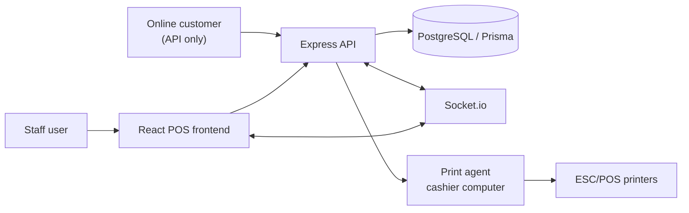

The application has two API surfaces:

- `/api/pos` — staff POS application.
- `/api/online` — customer/order/payment API. There is no customer-facing web
  frontend in this repository.

## 2. Staff role use cases

```mermaid
flowchart TB
    SA["SUPER_ADMIN"]
    PA["POS_ADMIN"]
    OA["ONLINE_ADMIN"]
    OT["ORDER_TAKER"]
    K["KITCHEN"]

    Login((Log in))
    Staff((Manage staff))
    Setup((Manage kitchens, categories,<br/>menu, deals, add-ons))
    Employee((Manage employees,<br/>attendance, payroll))
    POS((Create and manage POS orders))
    Orders((View and manage orders))
    Inventory((Manage inventory))
    Reports((View reports and exports))
    Vendors((Manage vendors and ledger))
    Online((Review online orders/payments<br/>and online availability))
    Taker((Submit and track reception orders))
    KitchenQueue((View own kitchen queue))
    ItemStatus((Update item preparation status))
    Print((Print receipts and kitchen tickets))

    SA --> Login
    SA --> Staff
    SA --> Setup
    SA --> Employee
    SA --> POS
    SA --> Orders
    SA --> Inventory
    SA --> Reports
    SA --> Vendors
    SA --> Online
    SA --> Print

    PA --> Login
    PA --> Setup
    PA --> Employee
    PA --> POS
    PA --> Orders
    PA --> Inventory
    PA --> Reports
    PA --> Vendors
    PA --> Print

    OA --> Login
    OA --> Online
    OA --> Setup

    OT --> Login
    OT --> Taker

    K --> Login
    K --> KitchenQueue
    K --> ItemStatus
    K --> Print
```

### Role behavior

- `SUPER_ADMIN` manages staff accounts and all POS administration.
- `POS_ADMIN` manages normal POS operations.
- `ONLINE_ADMIN` handles online availability and online payment/reception
  functions.
- `ORDER_TAKER` uses only the Taker shell: `/take-order` and `/my-orders`.
- `KITCHEN` uses only `/kitchen-display`.
- Kitchen users do not receive the normal sidebar or POS shell.
- Order takers do not receive the normal admin shell.

## 3. Empty-database setup workflow

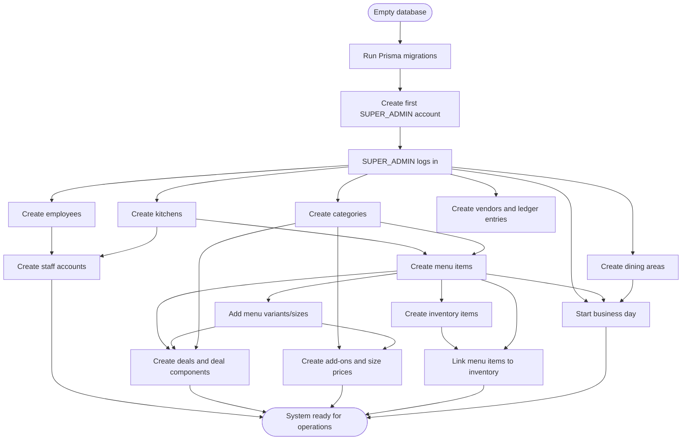

### Recommended setup order

1. Run migrations.
2. Create the first `SUPER_ADMIN`.
3. Log in.
4. Create kitchens.
5. Create categories.
6. Create employees.
7. Create staff users and assign roles.
8. Create dining areas.
9. Create menu items and assign each item to a kitchen.
10. Add variants and sizes.
11. Add add-ons and prices.
12. Create deals.
13. Create inventory items and link them to menu items.
14. Create vendors if purchasing is needed.
15. Start a business day.

## 4. Data relationships

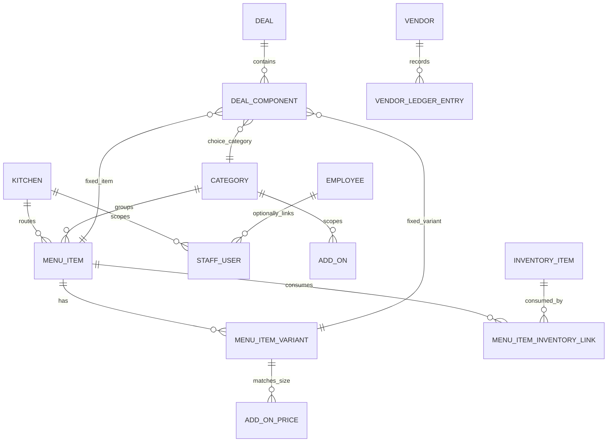

## 5. POS order workflow

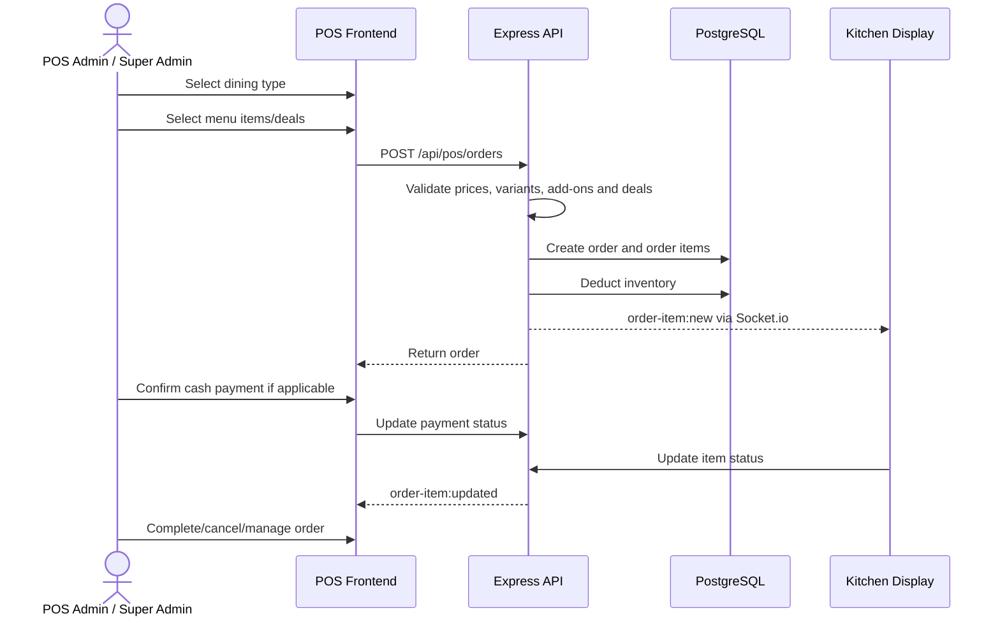

POS orders support dine-in, takeaway, deals, sized items, add-ons, customized
deals, and POS-only open-price items. The backend validates prices and totals.

## 6. Order-taker workflow

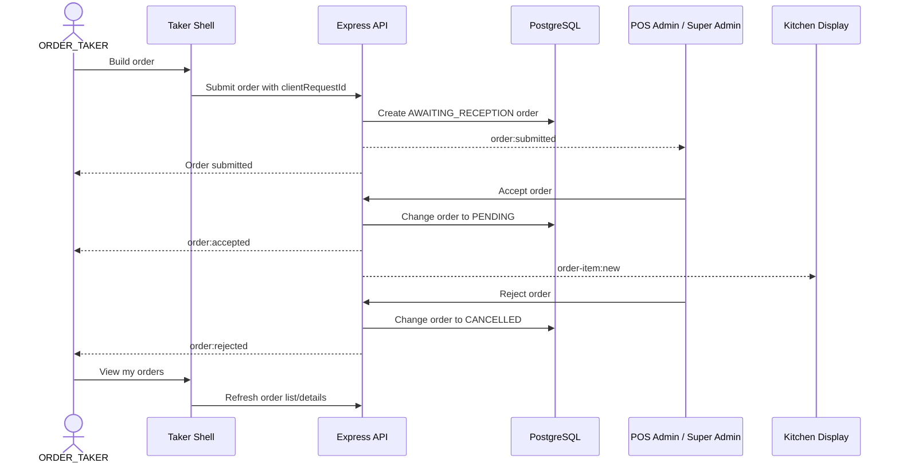

Order-taker orders wait for reception review before reaching the kitchen.

## 7. Kitchen workflow

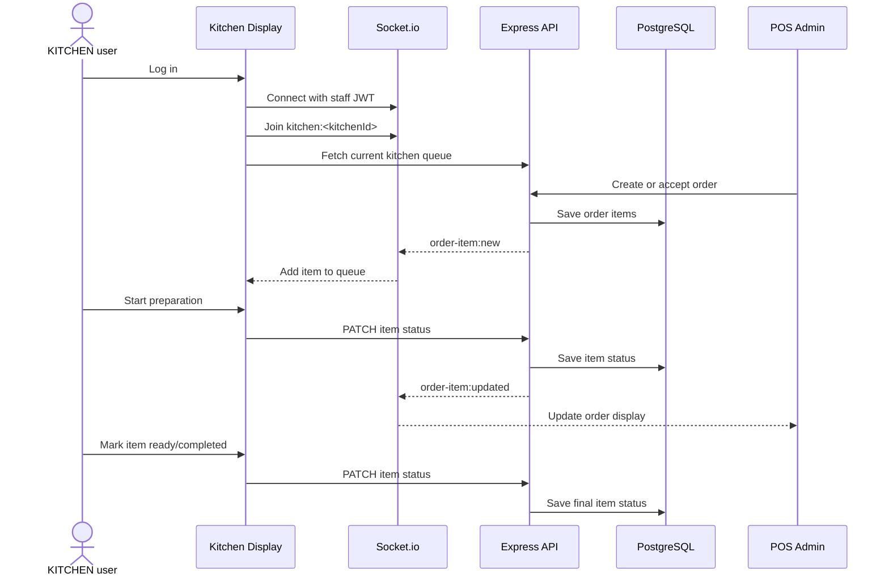

A kitchen user can join only the room for their assigned kitchen.

## 8. Online order and reception workflow

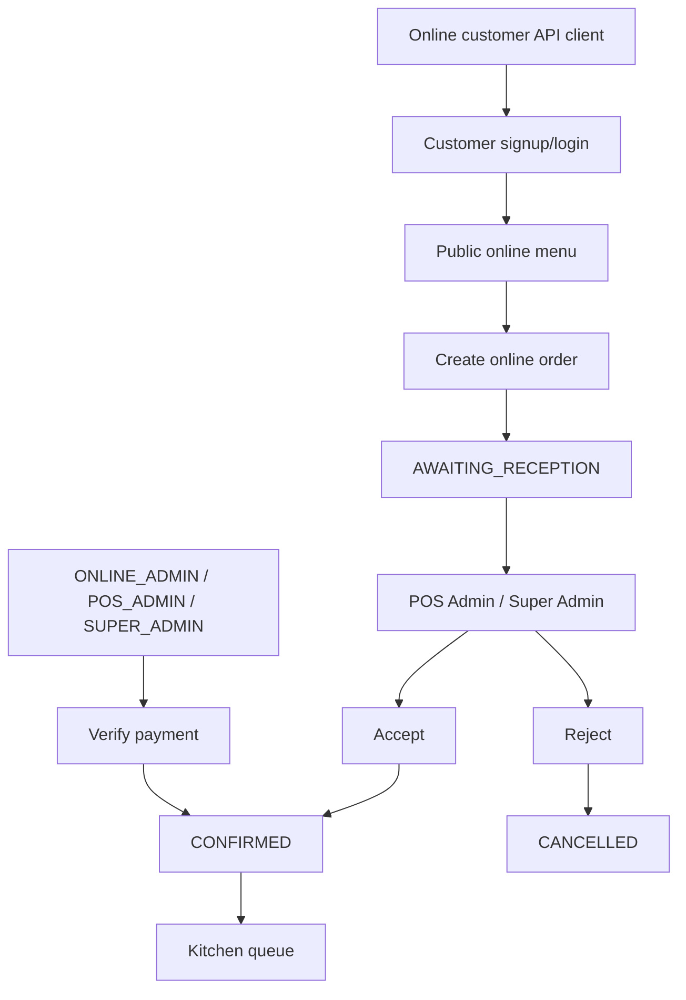

There is no customer-facing online-ordering frontend in this repository.

## 9. Printing workflow

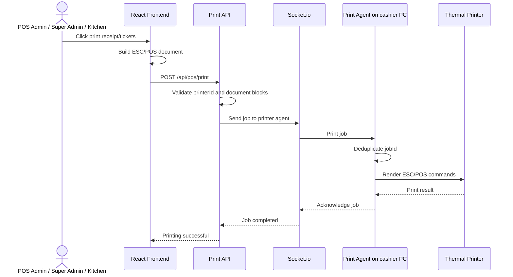

### Printing fallback

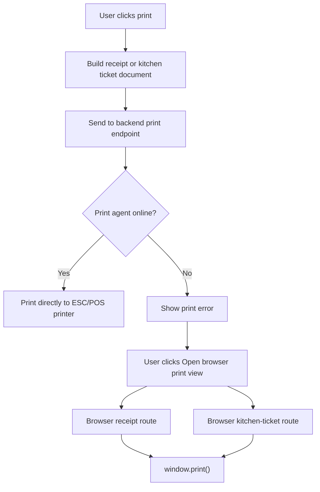

The print agent runs separately on the cashier's computer and is not deployed
with Railway.

## 10. Business-day workflow

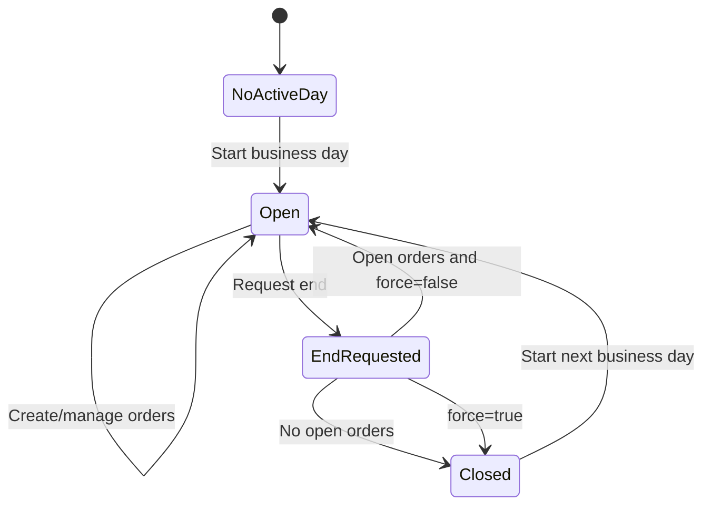

Orders cannot be created unless a business day is active.

## 11. Inventory workflow

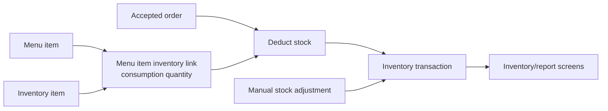

Cancelled orders do not automatically restock inventory in the current
implementation.

## 12. Employee, attendance and payroll workflow

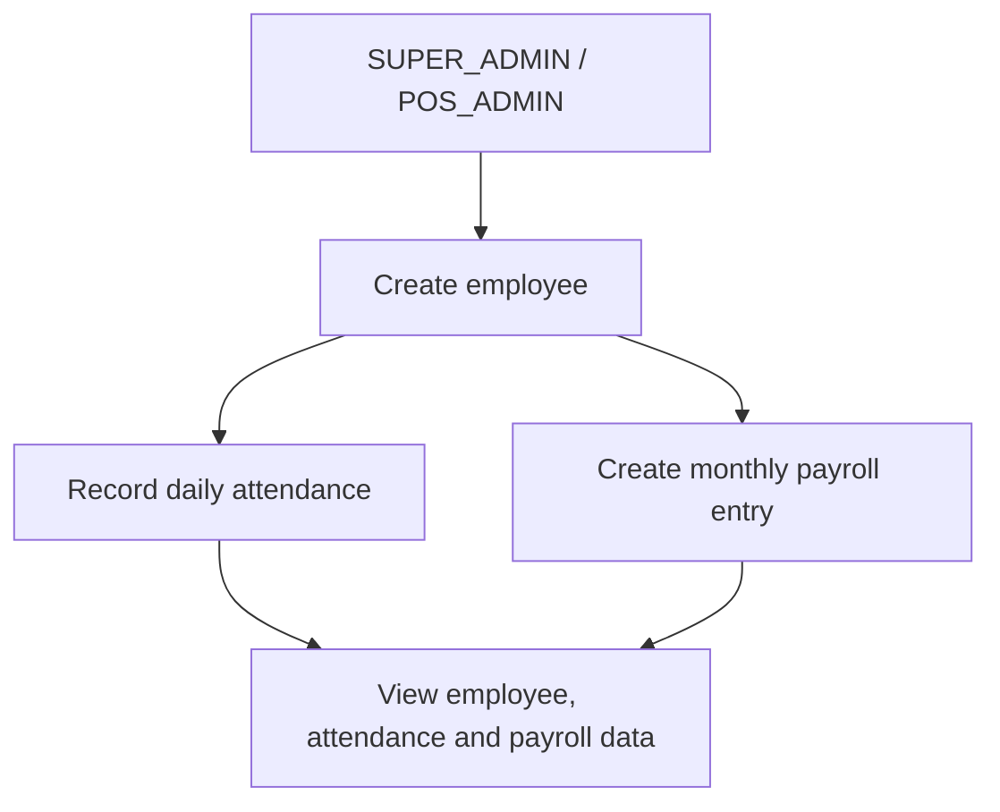

`Employee` is a payroll/workforce record. `StaffUser` is a login account. A
staff user may optionally be linked to an employee.

## 13. Vendor ledger workflow

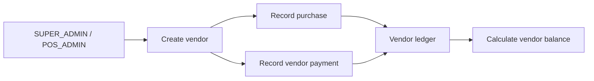

## 14. Complete operational workflow

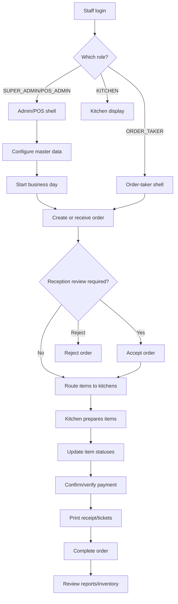

## 15. Current implementation notes

- The first admin account must be created separately; migrations do not create
  staff, kitchens, menu data, or a business day.
- Staff management is restricted to `SUPER_ADMIN`.
- Kitchens must exist before menu items can be assigned.
- Menu items must exist before inventory links and deal components can refer to
  them.
- An active business day is required before creating orders.
- The backend calculates and validates money values; client-supplied totals
  are not trusted.
- Kitchen displays use Socket.io for live order-item events.
- Order-taker orders require reception acceptance.
- Browser print routes are the fallback when the print agent is unavailable.
- The print agent is a separate process running on the cashier's computer.
## Order-taker change approval

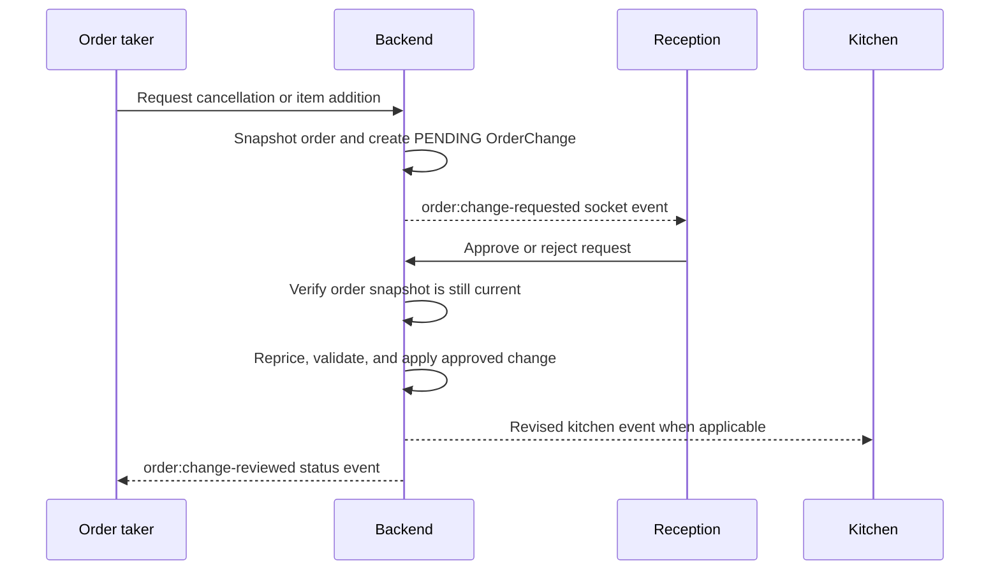
