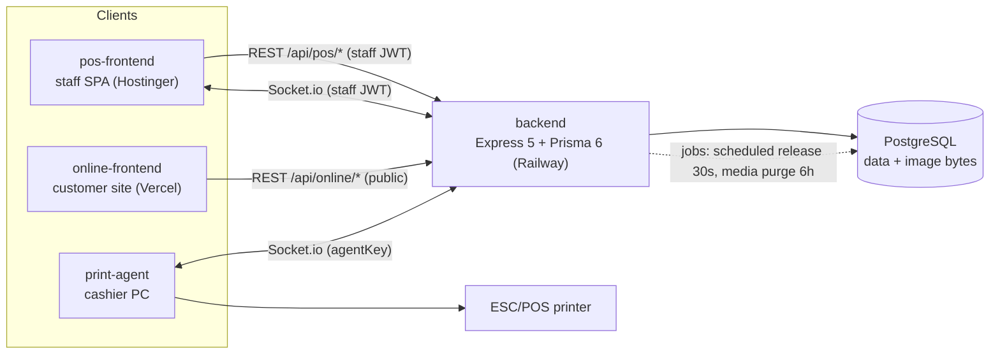
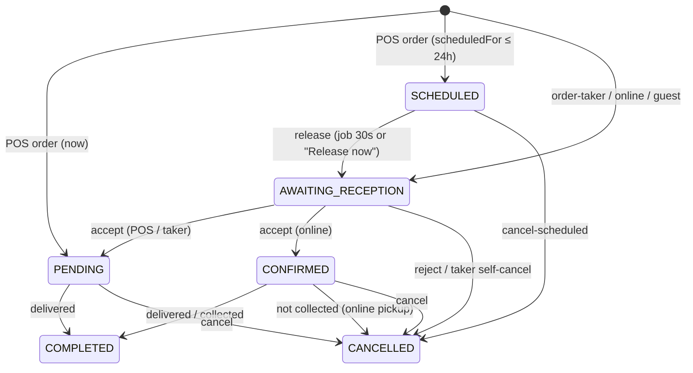
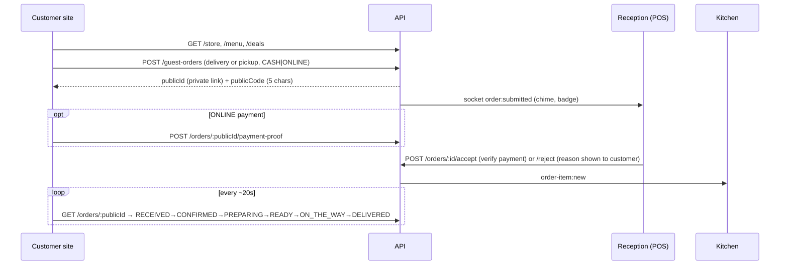
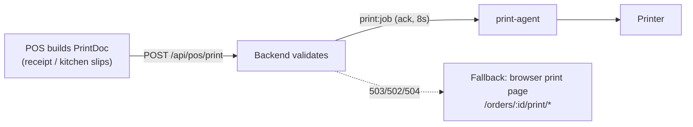
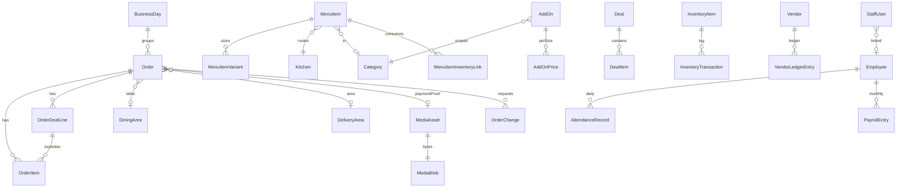

# Zoryx — Platform Context (one-page map)

Single-restaurant platform: staff POS, live kitchen screens, waiter phones, a public ordering website, and thermal printing. One backend, one database.
Detail lives in: [AS_BUILT_BACKEND](./AS_BUILT_BACKEND.md) · [AS_BUILT_FRONTEND](./AS_BUILT_FRONTEND.md) · [WORKFLOWS](./WORKFLOWS.md) · [PRINT_PROTOCOL](./PRINT_PROTOCOL.md) · [ONLINE_SITE_BRIEF](./ONLINE_SITE_BRIEF.md). Snapshot: 2026-11-16.

---

## 1. System at a glance

| Folder | What | Stack | Deployed |
|---|---|---|---|
| `backend/` | REST + Socket.io API, jobs | Express 5, Prisma 6, Postgres, sharp, exceljs, JWT/bcrypt | Railway (`start` runs `migrate deploy`) |
| `pos-frontend/` | Staff app (all staff roles) | React 19, Vite, TS, Tailwind v4, React Query, axios, socket.io-client, recharts | Hostinger |
| `online-frontend/` | Customer site, Urdu-first (RTL) + English, guest checkout | React 19, Vite, TS, Tailwind v4, React Query | Vercel |
| `print-agent/` | Receives print jobs, drives thermal printer (USB/LAN/COM/preview) | Node + TS | Cashier PC (Windows startup) |

No root package — each app builds alone. No automated tests in the frontends; backend has unit tests (`*.test.ts`).

---

## 2. Roles

| Role | Lands on | Can do |
|---|---|---|
| `SUPER_ADMIN` | `/dashboard` | Everything, plus Staff accounts and Kitchen writes |
| `POS_ADMIN` | `/dashboard` | Orders, reception, business day, menu/setup, team, inventory, vendors, reports, online store |
| `ONLINE_ADMIN` | `/online-store/menu` | Online store pages + Incoming Orders (**ONLINE source only**, no discounts, no prices) |
| `ORDER_TAKER` (waiter) | `/take-order` | Own phone shell: submit dine-in orders to reception, track/edit/cancel own orders, request changes |
| `KITCHEN` | `/kitchen-display` | Own kitchen's queue only, advance item status. No app shell/nav |

Role is checked on every route (server) **and** before rendering a screen (client).

---

## 3. Core rules (read these first)

- **Business day** = the unit of everything (order numbers, dashboard, reports). One active at a time. No order without one. Order #s restart per day.
- **Server prices everything.** Clients send `{menuItemId, variantId?, addOnIds?, quantity, notes?}` / `{dealId, quantity}`. Only POS staff may send `unitPrice` (open-price items) or a deal `customization.finalPrice`.
- **Money** = `Decimal(10,2)` on server, **strings** in JSON. `total = items + deals − discount + deliveryFee`.
- **Reception gate:** order-taker, online, and released scheduled orders arrive as `AWAITING_RECEPTION`. Nothing reaches a kitchen, moves stock, or counts in sales until reception **accepts**.
- **Errors** = `{error}` (guest/public routes: `{code, error}`); show the message as-is.
- **Times** stored UTC; shown in Pakistan time (`Asia/Karachi`).

---

## 4. Order model & lifecycle

**Type** `DINE_IN | TAKEAWAY | DELIVERY` · **Source** `POS | ORDER_TAKER | ONLINE | PHONE (unused)` · **Payment** `CASH | ONLINE`, status `PENDING → AWAITING_VERIFICATION → VERIFIED | REJECTED`.

`IN_KITCHEN` / `READY` exist in the enum but nothing sets them. Kitchen progress lives on **items**: `PENDING → PREPARING → READY → SERVED`.

**Line features:** sizes (variants), add-ons (per category, priced per size), open-price items (cashier types price, min/max), deals (fixed bundles, exploded into ₨0 items per kitchen; POS can customize contents + final price), per-line notes (≤100 chars, editable after placing → kitchen gets `note-updated`).

---

## 5. Key flows

**POS (cashier):** New Order → pick type/table/waiter/rider → grid + search + cart → place → kitchens get tickets live, stock auto-deducts → print table receipt / kitchen slips → Confirm Payment (discount, cash taken, change) → Mark delivered.

**Order taker:** pick table → cart → "Send to reception" (`clientRequestId` makes retries safe) → reception accepts/edits/rejects → live status + chime on phone. After acceptance: request EDIT/CANCEL → reception approves/rejects.

**Online guest:**

Guards: honeypot field, Postgres-counted limits (IP 5/10 min & 30/day; phone 3 waiting & 10/day), max 40 lines / qty 50 / total 200,000, area minimum, "not collected" strikes (3 in 90 days blocks a phone). Ordering open = site switch ON **and** business day active.

**Scheduled:** saved and numbered but invisible to kitchens/stock/sales/Incoming until released; day can't end while any are on hold.

**Kitchen:** `/kitchen-display` loads queue once, then socket `order-item:new / updated / note-updated`; tap to advance item status.

**Printing:**

One slip per kitchen, each listing all items (own kitchen bold), `[ADDED]` marks on additions. Agent dedupes jobs for 2 min.

**Business day:** Start → operate → End. End is blocked by open orders (`PENDING/CONFIRMED/IN_KITCHEN/READY/AWAITING_RECEPTION`; `force` overrides) and always by `SCHEDULED` ones (release/cancel offered).

**Back office:** inventory (AUTO items deducted by menu links on order/accept, MANUAL adjusted by hand, low-stock filter) · vendor ledger (purchases/payments, balance computed) · employees (attendance grid, monthly payroll: `base + allowance − deduction − advance − paid`).

---

## 6. Screens

### POS frontend (`pos-frontend`)

| Route | Screen | Roles | Purpose |
|---|---|---|---|
| `/login` | Login | all | Staff sign-in |
| `/dashboard` | Dashboard | SA, PA | KPIs, period selector (today…custom), trends, hourly, breakdowns, top items, cancellations (`/reports/analytics`) |
| `/orders` | Orders | SA, PA | List + filters, customer column, cash paid toggle, xlsx export |
| `/orders/new` | New Order | SA, PA | Grid, search, sizes, add-ons, open price, deal customize, notes, table picker, Now / Schedule |
| `/orders/:id` | Order Detail | SA, PA | Items by kitchen, notes, assign, add/remove items, confirm payment, cancel, deliver, print, online-order card |
| `/incoming-orders` | Incoming Orders | SA, PA, OA | Reception inbox: accept / print-and-send / edit / reject, find by code, payment proof, change requests |
| `/scheduled`, `/scheduled/:id/edit` | Scheduled | SA, PA | On-hold orders: release, retime, edit items, cancel |
| `/menu` | Menu (tabs: Items, Add-ons, Deals) | SA, PA | CRUD, price type (fixed/sizes/open), online toggle |
| `/categories` `/kitchens` `/dining-areas` | Setup | SA, PA (kitchen writes SA) | CRUD; dining areas have free-text area/room |
| `/employees` | Employees (list, attendance, payroll) | SA, PA | HR |
| `/inventory` | Inventory (items, adjust, menu links) | SA, PA | Stock |
| `/vendors`, `/vendors/:id` | Vendor Ledger | SA, PA | Suppliers + running balance |
| `/reports` | Reports | SA, PA | Sales by day/month + daily/monthly xlsx |
| `/staff` | Staff | SA | Accounts, roles, reset password, deactivate |
| `/online-store/menu` | Menu photos & names | SA, PA, OA | Photos, Urdu names, Show online, Popular, category photos |
| `/online-store/settings` | Store settings | SA, PA, OA | Accept-orders switch (live status), delivery/pickup toggles, shop info, contact, hours, announcement, socials |
| `/online-store/delivery-areas` | Delivery areas | SA, PA, OA | Fee + minimum, reorder, hide (max 30) |
| `/online-store/payment-accounts` | Payment accounts | SA, PA, OA | Easypaisa/JazzCash/bank + QR (max 4) |
| `/online-store/gallery` | Gallery | SA, PA, OA | Bulk photo upload, captions (max 24) |
| `/online-store/testimonials` | Testimonials | SA, PA, OA | Real reviews, stars (max 12) |
| `/take-order`, `/my-orders` | Taker shell | OT | Waiter order entry + own orders |
| `/kitchen-display` | Kitchen Display | K | Live ticket queue |
| `/orders/:id/print/receipt`, `/print/kitchen-tickets` | Print fallbacks | SA, PA | Browser print (80mm) |

Shell: desktop sidebar (groups Operations / Online store / Setup / Team / Insights) + top bar with Business Day bar; mobile bottom tabs + "More" sheet. App-wide Incoming badge/toast/chime. Session in `localStorage`; 401 with token → logout.

### Customer website (`online-frontend`)

| Route | Purpose |
|---|---|
| `/` | Home: hero, announcement, categories, popular/deals, gallery, reviews, how to order, call/WhatsApp/map |
| `/menu` | Category chips, item cards, size/add-on sheet, deals, cart pill → cart → checkout sheet (delivery vs pickup, area, address, CASH/ONLINE) |
| `/order/:publicId` | Private status page: timeline, items, totals, payment steps (copy account, QR, upload proof, WhatsApp), reject reason |
| `/orders` | Orders placed from this phone (last 10, local), track, reorder |
| `/more` | Language, find us, install app, haptics, clear saved details |

Phone app-shell under 768px (tab bar, sheets), offline banner, works with API down (static home + phone). Stores only cart/details/history in `localStorage`; no cookies/analytics. Strict CSP.

---

## 7. API reference

Base: `VITE_API_URL`. Staff routes need `Authorization: Bearer <staff JWT>` (12h). Roles: SA=SUPER_ADMIN, PA=POS_ADMIN, OA=ONLINE_ADMIN, OT=ORDER_TAKER, K=KITCHEN, *any*=any staff. Health: `GET /health`, `/api/pos/health`, `/api/online/health`.

### Staff — `/api/pos`

| Area | Endpoints | Roles |
|---|---|---|
| Auth | `POST /auth/login` {username,password} → {token, staff} | public (10 fails/15 min) |
| Business day | `GET /business-day/current` · `POST /start` {label?} · `POST /end` {force?} | read +OT; write SA, PA |
| Staff | `GET / ` `GET /:id` `POST /` `PUT /:id` `DELETE /:id` (deactivate) on `/staff` | SA |
| Kitchens | `GET /kitchens` `GET /:id` · `POST` `PUT /:id` `DELETE /:id` | read any; write SA |
| Categories | `GET /categories` `GET /:id` · `POST` `PUT` `DELETE` · `PATCH /:id/online-content` | read any; write SA, PA; online +OA |
| Menu | `GET /menu?kitchenId=` `GET /:id` · `POST` `PUT /:id` `DELETE /:id` · `POST /:id/variants` `PUT|DELETE /:id/variants/:variantId` · `PATCH /:id/online-availability` · `PATCH /:id/online-content` | read any; write SA, PA; online-* +OA |
| Add-ons | `GET /addons` `GET /:id` · `POST` `PUT /:id` `DELETE /:id` · `PUT|DELETE /:id/prices/:size` | read any; write SA, PA |
| Deals | `GET /deals` `GET /:id` · `POST` `PUT /:id` `DELETE /:id` · `PATCH /:id/online-content` | read any; write SA, PA; online +OA |
| Dining areas | `GET /dining-areas` `GET /:id` · `POST` `PUT /:id` `DELETE /:id` | read SA, PA, OT; write SA, PA |
| Employees | `GET|POST /employees` `GET|PUT|DELETE /:id` · `GET|POST /attendance` · `GET /payroll/current-month` `POST /payroll` | SA, PA |
| Inventory | `GET /inventory?lowStock=` `POST` `GET|PUT|DELETE /:id` `POST /:id/adjust` · `GET|POST /links` `GET|PUT|DELETE /links/:id` | SA, PA |
| Vendors | `GET|POST /vendors` `GET|PUT|DELETE /:id` · `GET|POST /:id/ledger` | SA, PA |
| Reports | `GET /reports/dashboard` · `/analytics?period=` · `/sales?from&to&groupBy` · `/export?type=daily|monthly&businessDayId` (xlsx) | SA, PA |
| Print | `POST /print` {printerId?, docs} · `GET /print/status` | SA, PA, OA, K |
| Media | `POST /media` multipart file + kind (MENU_ITEM/DEAL/CATEGORY/GALLERY/PAYMENT_QR), ≤8 MB | SA, PA, OA |
| Site content | `GET|PUT /site-settings` · CRUD `/delivery-areas` `/payment-accounts` `/gallery` `/testimonials` (`GET / POST / PUT /:id / DELETE /:id`) | SA, PA, OA |
| Kitchen queue | `GET /kitchen-queue?kitchenId=` | SA, PA, K (own) |

**Orders — `/api/pos/orders`**

| Endpoint | Purpose | Roles |
|---|---|---|
| `GET /` `?businessDayId&status&source&diningAreaId&export=xlsx` | List / export | SA, PA, OT (own) |
| `POST /` | Create POS order (`scheduledFor?`, open price, deal customization) | SA, PA |
| `GET /:id` | Detail | SA, PA, OT (own) |
| `POST /submit` | Waiter submits dine-in → reception | OT |
| `PUT /:id/submission` | Replace awaiting order's contents | OT (own), SA, PA |
| `GET /incoming?code=` | Reception inbox / find by code | SA, PA, OA (online only) |
| `POST /:id/accept` {paymentVerified?, paymentMethod?, discount?} | Accept → kitchen + stock | SA, PA, OA (online, no discount) |
| `POST /:id/reject` {reason, paymentRejected?} | Reject | SA, PA, OA (online) |
| `GET /scheduled` · `POST /:id/release` · `PATCH /:id/schedule` · `PUT /:id/scheduled-items` · `POST /:id/cancel-scheduled` | Scheduled orders | SA, PA |
| `PATCH /:id/cancel` | Cancel (OT: own, still awaiting) | SA, PA, OT |
| `PATCH /:id/assign` | waiter / rider / table | SA, PA |
| `PATCH /:id/payment-status` | Cash paid/unpaid, discount, paidAmount | SA, PA |
| `POST /:id/items` · `DELETE /:id/items/:itemId` | Add / remove items | SA, PA |
| `PATCH /:id/items/:itemId/notes` · `PATCH /:id/deal-lines/:dealLineId/notes` | Edit notes | SA, PA |
| `PATCH /:id/items/:itemId/status` | Item status | SA, PA, K (own kitchen) |
| `POST /:id/delivered` · `POST /:id/not-collected` | Complete / pickup no-show | SA, PA |
| `GET /:id/payment-proof?size=` | Proof image (blob) | SA, PA, OA |
| `GET /:id/changes` · `POST /:id/changes` | Taker change requests | read OT, SA, PA; create OT |
| `GET /changes/incoming` · `PATCH /changes/:changeId/review` | Review change requests | SA, PA |

### Public / customer — `/api/online`

| Endpoint | Purpose |
|---|---|
| `GET /store` | Settings, delivery areas, payment accounts, gallery, testimonials, `orderingOpen`, `closedReason` (cached 60s) |
| `GET /menu` · `GET /deals` | Online-available catalogue (cached 60s) |
| `GET /media/:id?size=thumb|full` | Image bytes (immutable, ETag) |
| `POST /guest-orders` | Guest order (delivery or pickup) → `{publicId, publicCode, orderNumber, total, …}` |
| `GET /orders/:publicId` | Customer status page (no PII) |
| `POST /orders/:publicId/payment-proof` | Upload proof (≤5 MB) |
| `GET /payment/pending` · `PATCH /payment/:orderId/verify|reject` | Staff (SA, PA, OA) payment checks — no dedicated screen; reception verifies on accept |
| `POST /auth/signup|login` · CRUD `/addresses` · `POST /orders` | Customer accounts — **off** unless `ENABLE_CUSTOMER_ACCOUNTS=true` (404) |

---

## 8. Real-time (Socket.io)

Connect with `auth: {token}`; admins `emit("join","pos-admin")`, kitchen `emit("join","kitchen:<id>")`; order takers auto-join `user:<staffId>`; OA may join `pos-admin` (listen only); print agent uses `auth: {agentKey, printerId}`.

| Event | To | When |
|---|---|---|
| `order-item:new` | `kitchen:<id>` | Order placed (non-gated), items added, order accepted |
| `order-item:updated` | kitchen + `pos-admin` | Item status changed |
| `order-item:note-updated` | `kitchen:<id>` | Note edited after placing |
| `order:submitted` | `pos-admin` | New awaiting order / scheduled released |
| `order:updated` / `order:accepted` / `order:rejected` | `pos-admin` (+ taker) | Reception actions, edits, proof upload |
| `order:status` | `user:<staffId>` | Taker's order accepted / rejected / cancelled |
| `print:job` (ack) | agent socket | Print dispatch |

No replay on reconnect (Incoming refetches on reconnect; Kitchen Display does not).

---

## 9. Data model (Prisma)

Also: `DealComponent` (choice slots, seed-only), `Customer`/`CustomerAddress` (accounts, off), `SiteSettings` (single row), `PaymentAccount`, `GalleryImage`, `Testimonial`, `OrderClientIp` (hashed IP for limits). Images live in Postgres (WebP, 4:3 crop; cut-outs keep transparency; QR lossless PNG). Migrations are additive only.

---

## 10. Ops & security

| Env (backend) | Purpose |
|---|---|
| `DATABASE_URL`, `JWT_SECRET`, `PORT` | Required |
| `CORS_ORIGIN` | Must list POS **and** customer-site origins |
| `PRINT_AGENT_KEY` | Enables print agents (unset = disabled) |
| `TRUST_PROXY_HOPS`, `LOG_CLIENT_IP` | Real client IP behind Railway |
| `ENABLE_CUSTOMER_ACCOUNTS` | Turn on customer accounts (default off) |

Frontends: `VITE_API_URL`, `VITE_PRINTER_ID`, `VITE_ONLINE_SITE_URL` (POS); `VITE_API_URL`, `VITE_SITE_URL` (site). Agent: `BACKEND_URL`, `PRINT_AGENT_KEY`, `PRINTER_ID`, `PRINTER_INTERFACE`, `PRINTER_WIDTH_CHARS`.

Security: bcrypt, staff password ≥8, deactivated staff rejected per request (HTTP; sockets keep working until token expiry), helmet, JSON 100 KB (50 KB online), in-memory per-IP rate limits (login, online 300/15 min, media 1000, guest orders 30, proof 20, status 600), uploads type-checked by bytes. First admin: `node scripts/create-admin.js`. Demo data: `DEMO_RESET_ALLOWED=true npm run demo:reset -- --yes` (wipes; refuses on a non-demo database with orders).

---

## 11. Known gaps

- `PHONE` source, `IN_KITCHEN`/`READY` order statuses: unused.
- Cancel doesn't restock or notify the kitchen; removing an item doesn't notify the kitchen; approved taker edits don't push to kitchen until reload.
- Kitchen Display doesn't recover events missed while disconnected.
- `DealComponent` choice slots have no admin UI/API (seed only).
- No dedicated payment-verification screen (done inside Incoming accept).
- Deleting a vendor with ledger entries returns 500.
- Reports bucket months in UTC; no PWA/offline in POS.
- Migration `20261111120000_cutout_photos…` written by hand — apply with `prisma migrate deploy`.
